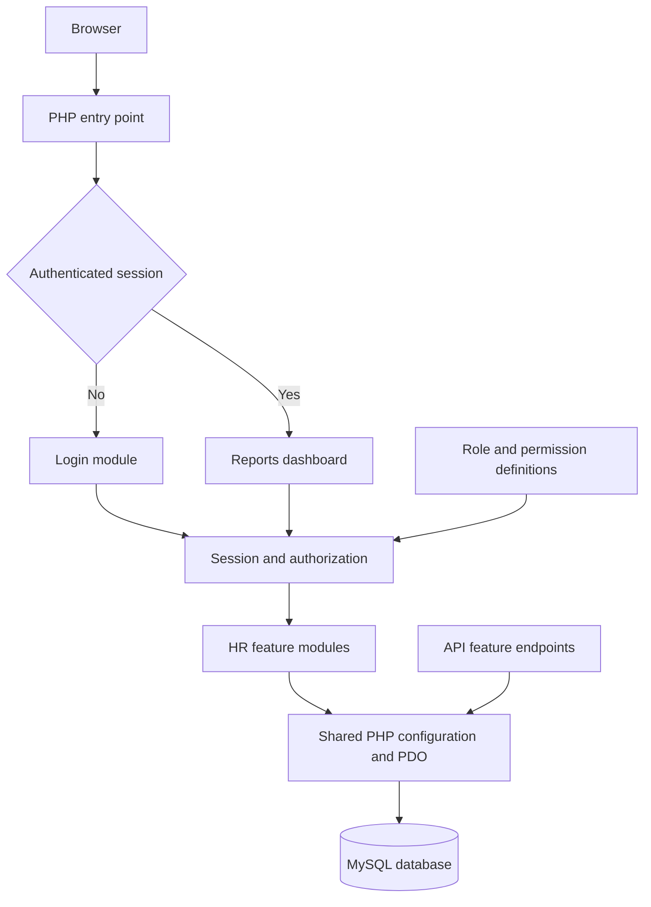

# Sistema Integral RH

> Human Resources Management System · PHP · MySQL · Role-based Access Control

A modular web application for human resources workflows. The repository includes code for employee administration, attendance, leave requests, payroll-related workflows, recruitment, performance evaluations, and reporting.

**Project status:** Portfolio / development project. Modules and supporting code exist in the repository, but this README does **not** certify production readiness or end-to-end functionality.

## Overview

Sistema Integral RH brings several HR administration workflows together in a PHP application backed by MySQL. Its codebase uses separate modules, API endpoints, shared configuration, and a role/permission model.

## Modules in the repository

| Module | Area covered |
| --- | --- |
| Employees | Employee-related records and actions |
| Attendance | Attendance events, corrections, and reports |
| Leave | Leave requests and approvals |
| Payroll | Payroll-related calculations and exports |
| Recruitment | Recruitment workflow |
| Performance | Performance evaluations |
| Documents | Document-related operations |
| Reports | Dashboards and export workflows |
| Users & authentication | Login, accounts, roles, and permissions |
| Audit & control | Audit and administrative controls |
| Communication | Announcements and communication tools |

These entries describe source-code modules and permission definitions, not independently verified working features.

## Technology stack

- **Backend:** PHP 8.1+ (as specified in `composer.json`)
- **Database:** MySQL via PDO
- **Dependencies:** Composer, PHPMailer
- **Testing:** PHPUnit 11 (development dependency)
- **Local environment:** Compatible with a PHP/MySQL local development environment such as XAMPP

## Repository structure

```text
api/              HTTP endpoints grouped by feature
assets/           Application assets
config/           Application, database, and role configuration
docs/             Existing deployment documentation
includes/         Shared application code
modules/          HR feature modules
sql/              Schema, migrations, and development seed scripts
tests/            PHPUnit tests
index.php         Application entry point
composer.json     PHP dependencies and test script
.env.example      Example environment settings
```

## Architecture overview

This **conceptual code-structure diagram** summarizes the PHP entry point, authentication, feature modules, role/permission checks, and PDO database access. It does not represent a verified production infrastructure.



**Source references:** [`index.php`](index.php), [`modules/reports/dashboard.php`](modules/reports/dashboard.php), [`config/roles.php`](config/roles.php), [`config/database.php`](config/database.php), and the [`api/`](api/) and [`modules/`](modules/) directories. Arrows summarize logical relationships rather than all runtime call paths.

## Local development

This is a **starting point** based on the repository configuration; a fresh installation has not been tested for this README.

1. Install PHP **8.1 or newer**, Composer, and MySQL in a local development environment.
2. Clone this repository into a directory served by your local PHP web server.
3. Run `composer install`.
4. Copy `.env.example` to `.env` and configure `APP_URL`, `DB_HOST`, `DB_PORT`, `DB_NAME`, `DB_USER`, and `DB_PASS`.
5. Create an empty **local development database**. Review `sql/schema.sql`, `sql/migrations/`, and the seed files before importing anything. The correct migration order and initial account setup must be checked against your local revision.
6. Open the configured local `APP_URL`. The root `index.php` redirects visitors to the login screen or dashboard based on their session.

**Avoid using development seed data or example credentials in any publicly accessible deployment.**

## Tests

The repository includes a PHPUnit configuration and a `tests/Unit/` folder.

```bash
composer install
composer test
```

These commands describe the configured test entry point. **No tests were executed** as part of this documentation update.

## Deployment and security

An existing guide is available at [`docs/DEPLOY_NEUBOX.md`](docs/DEPLOY_NEUBOX.md). Read and verify its assumptions rather than treating it as a security certification.

**Important before production deployment:**

- Never publish a populated `.env`, actual HR records, payroll data, employee documents, or credentials.
- Audit `uploads/`, SQL seeds and backups, tracked files, and Git history for sensitive information.
- The existing deployment documentation references a previously exposed credential. Confirm that all affected secrets were rotated and no longer grant access; deleting a file from the latest commit is not sufficient to remove an exposure from Git history.
- Review role permissions, file-upload handling, authentication, and deployment configuration.
- Use synthetic data for portfolio screenshots and demonstrations.

## Future portfolio improvements

- Add screenshots using anonymized or synthetic data
- Document a verified clean installation and database initialization
- Run and publish automated test results
- Add an architecture diagram and module-level workflows
- Review deployment security before hosting a live demo

---

**Maintained by:** [Rubén Casares](https://github.com/RubenCasaresR)
